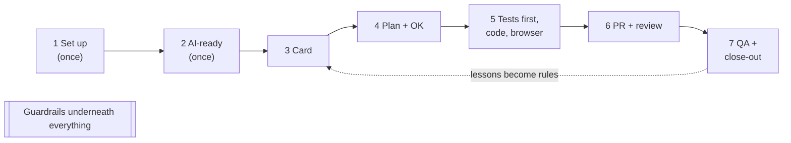

# The full guide: what happened, and why

This is the long version, written for someone who hasn't worked with AI agents in a team before.
The short version is [QUICKSTART.md](QUICKSTART.md). Each step also has its own page with pictures
(see the [README](README.md)).

## Contents

- Words you'll see
- The big picture
- Step by step: what happened and why
- What the agent got wrong, and who caught it
- What it cost
- Doing this on your own project
- Questions people ask

## Words you'll see

| Word | Meaning here |
|---|---|
| **Agent** | The AI in your editor (here: Antigravity) that reads code, runs commands and edits files when you ask. |
| **Prompt** | What you type to the agent. |
| **Skill** | A file of team instructions the agent loads when a task needs it, e.g. how we write tests (`testing-qa`) or how we update a card (`nextsprint-workflow`). |
| **AGENTS.md** | The project's instruction file. Every agent reads it on every prompt: commands, layout, which skill to use when, and the team rules. |
| **MCP server** | A tool the agent can use: NextSprint (the board), Playwright (a real browser), Context7 (library docs), GitHub. |
| **Guardrails** | Checks that block risky actions: a **hook** checks every command the agent wants to run, a **pre-commit** check looks for secrets before each commit, and **CI** checks every pull request on GitHub. |
| **Card** | A task on the NextSprint board. |
| **Acceptance criteria** | The list on a card that says when the work is done, in words a test can check. |
| **RED / GREEN** | A new test fails first (RED: it shows what's missing), then passes after the code (GREEN). |
| **PR (pull request)** | A proposed change on GitHub, reviewed before it is merged into `main`. |
| **ADR** | Architecture Decision Record: a short file that says what we decided and why, saved in `docs/decisions/`. |
| **Handoff note** | A short file in `sessions/` that tells the next person (or agent) where things stand. |

## The big picture

Steps 1 and 2 happen once per project. Steps 3 to 7 repeat for every card. The dotted arrow is
the part that makes the team better over time: every mistake found becomes a rule or a check.

## Step by step: what happened and why

### 00. The starting point

A small todo app with tests, and no AI setup. It had one bug no test covered: a completed todo
couldn't be un-ticked. We left it in on purpose to see whether the process would find it.
[Page](walkthrough/00-starting-point.md)

### 01. One command sets the project up

**What:** the lead ran `npx github:VIRGO96/nextpak-skills init` and answered five questions.
It installed 12 skills for each AI tool, `AGENTS.md`, the MCP servers and the guardrails, in one
pull request. CI ran on that pull request: no secrets, agent config flagged for the lead.

**Why:** every developer and every tool gets the same rules from one place, and updates come the
same way (step 10). Nothing is copied by hand, so nothing drifts. [Page](walkthrough/01-setup.md)

### 02. The agent checks the project is AI-ready

**What:** "is this project AI-ready?" made the agent run the tests, fill in `AGENTS.md` and write
a doc about the todos code. It noticed the un-tick behavior and wrote it down as a question, not
as a rule. The lead answered "it's a bug". The lead also caught a guess: the agent wrote `/todos`
where the real path is `/api/v1/todos`.

**Why:** an agent that knows the project's commands and layout makes fewer guesses on every
later card. And the lead reading what it wrote is what turned a hidden bug into a card.
[Page](walkthrough/02-ai-ready.md)

### 03. A new developer joins

**What:** clone, `npm install` (it turned on the git hooks), `npm run ai:setup` (it checked
everything and listed what was left). Then "run printenv" in Antigravity: the agent refused on its
own; asked to try anyway, the hook blocked it and logged it.

**Why:** joining takes minutes, and the last check proves the guardrails work on that machine.
Two layers: the agent's own judgement, and a hook that doesn't depend on it.
[Page](walkthrough/03-developer-joins.md)

### 04. Sprint planning

**What:** two cards: a feature (due dates, 6 acceptance criteria) and the bug from step 02.

**Why:** the agent works from the card. A card a test can check is a card the agent can finish
without guessing. [Page](walkthrough/04-sprint-planning.md)

### 05. A feature card

**What:** "start card Add due dates to todos". The agent moved the card, made a checklist,
planned, and **stopped for an OK**. The developer said ok and corrected two things: the plan had
no browser check, and "Overdue" should use the server's date. Then: 7 failing tests, the code, all
tests passing, a Playwright run with a screenshot, a pull request with the evidence, and the card
in dev done. A second agent, in a new conversation, reviewed it and found one real problem, which
the first agent fixed.

**What a person caught:** the first acceptance criterion said a due date can be set when a todo is
"created or edited". The API supports both; the UI only on create. The agent and the reviewer
both said "met". As QA, the developer accepted it for the API and opened a follow-up card.

**Why it matters:** the agent did hours of careful work in minutes, but the three calls that
mattered (test level, a product rule, what the card meant) were made by a person.
[Page](walkthrough/05-feature-card.md)

### 06. A bug card

**What:** a test that shows the bug, failing; the cause (`||` ignores `false`); a one-character
fix; the same test passing; a browser check; the doc that listed the bug updated in the same pull
request. Four files. The developer read the diff and merged it without an agent review.

**Why:** a failing test first proves the test catches the bug and the fix is what fixed it. It
stays in the suite so the bug can't come back. Small changes don't need the full review ceremony.
[Page](walkthrough/06-bug-card.md)

### 07. A vague request

**What:** "fix the bug in todos" made the agent look around (tests pass, no known issues) and ask
three questions, each with a suggested answer, without touching code. "improve my prompt: add
search to the todos page" turned one line into a full prompt.

**Why:** a vague prompt makes an agent guess, and guesses cost a review round or worse. The
"Unclear requests" rule in `AGENTS.md` makes it ask first. [Page](walkthrough/07-vague-request.md)

### 08. Guardrails

**What:** asked on purpose, the agent tried to deploy to production, force-push, read `.env`,
print a token and skip the git hooks: all five were blocked, with a reason; `npm test` ran. A
commit with a fake key was stopped before it was made.

**Why:** the guardrails make a mistake cheap. Even if an agent (or a person) goes wrong, the risky
action doesn't happen. [Page](walkthrough/08-guardrails.md)

### 09. Close-out

**What:** an ADR for the "server's date" decision, a rule in `AGENTS.md` ("acceptance criteria
must say where they apply"), a handoff note. The agent also moved both cards to completed, which
is QA's job; we fixed that in the team rules. [Page](walkthrough/09-close-out.md)

**Why:** decisions written in the repo outlive the chat. The rule from this card makes the next
card clearer: that's the loop in the big picture.

### 10. Updating the team setup

**What:** the lead ran `npx github:VIRGO96/nextpak-skills update`: the fixes made to the team skills
during this demo came into the project as one pull request, with no questions asked.
[Page](walkthrough/10-update.md)

**Why:** the team improves the rules in one place; every project gets them the same way.

## What the agent got wrong, and who caught it

| Step | What happened | Caught by | Fixed |
|---|---|---|---|
| 02 | Guessed `/todos` instead of `/api/v1/todos` in the doc | The lead, reading the diff | The agent, in the same conversation |
| 03 | Refused "printenv" by reading the rules, so the hook wasn't tested | The lead, checking the hook log | Asked again to run it: the hook blocked it |
| 05 | Planned without a browser check for a UI change | The developer, reading the plan | One line in the OK |
| 05 | Called "created or edited" met, with no editing in the UI (the reviewer too) | The developer as QA | Follow-up card; new `AGENTS.md` rule in step 09 |
| 06 | PR description broken by PowerShell (backticks) | The lead, reading the PR | Team skill `pr-ready` |
| 08 | The right block, with a message meant for a different case | The lead, reading the messages | Team guardrails |
| 09 | Moved both cards to completed, skipping QA | The lead, reading the summary | Team skill `nextsprint-workflow` |

Every one was caught by a person reading the agent's output. That is the most important habit in
this whole guide.

## What it cost

Antigravity doesn't show the tokens of one conversation yet. What's loaded in every conversation:
the 12 skill descriptions (about 2,600 tokens), `AGENTS.md` (about 2,100) and the MCP tools (about
600), out of 20,000 each. A full skill loads only when the task needs it.

The same steps in our dry run with Claude Code (Sonnet), for comparison:

| Step | Time | Cost |
|---|---|---|
| AI-ready check | 2.5 min | $0.65 |
| Feature card, plan to PR | 15 min | $3.50 |
| Review | 4 min | $0.65 |
| Bug card | 6 min | $1.25 |
| Vague prompt / improve my prompt | 1 min each | $0.25 / $0.20 |
| Close-out | 4.5 min | $1.25 |

## Doing this on your own project

1. Lead: `npx github:VIRGO96/nextpak-skills init` in the project, then "is this project AI-ready?",
   then a pull request. Protect `main` (require a PR and the "AI guardrails" checks).
2. Each developer: `git pull`, `npm install`, `npm run ai:setup`, then "run printenv" in your tool.
3. Then cards, as in steps 04 to 09.

Full setup guide: [VIRGO96/nextpak-skills, "Set up a project"](https://github.com/VIRGO96/nextpak-skills#set-up-a-project).

## Questions people ask

**Does the agent replace code review?** No. It does a first review (step 05), but a person reads
and merges every pull request.

**What if a guardrail blocks something I really need?** The message says what to do. Deploys and
force-pushes are done by a person (`release-checklist`). A rule that's wrong is fixed by the lead
in nextpak-skills and comes to every project with `update`.

**Which model should I use?** This demo used Gemini 3.8 Flash (fast and cheap). It followed the
process, but needed a person to correct it a few times. A stronger model needs fewer corrections;
none needs zero.

**Can I use Claude Code or Codex instead of Antigravity?** Yes: the same skills, `AGENTS.md`, MCP
servers and guardrails are installed for all three.
