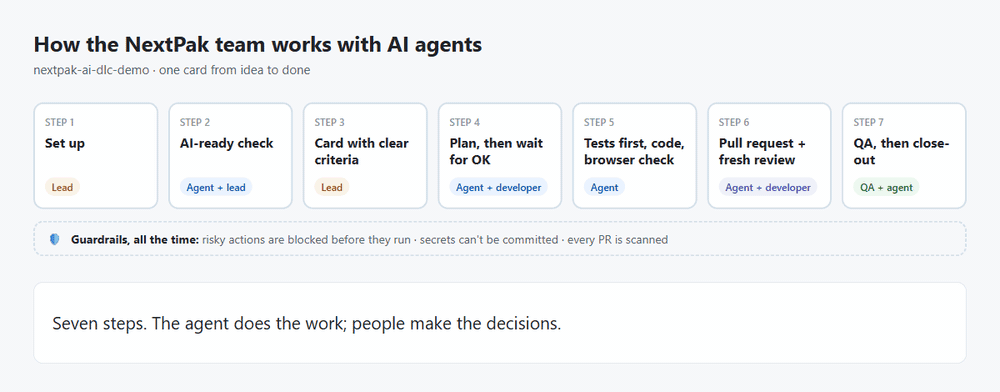

# NextPak AI-DLC demo

A small todo app, built one step at a time, to show how the NextPak team works with AI agents:
setting a project up, getting it AI-ready, picking up a card, fixing a bug, reviewing, and
closing out. Every step is a commit (or a pull request) with a short page that explains it in
plain language, with a picture.



## Start here

| You have | Read |
|---|---|
| 5 minutes | [QUICKSTART.md](QUICKSTART.md): the seven steps, the prompts to copy, five rules |
| 30 minutes, or you're new to AI agents | [GUIDE.md](GUIDE.md): what happened at each step and why, the words you'll see, what the agent got wrong and who caught it |
| Time to see every step | The table below: each page has a picture, the exact prompts, and what changed |

## The steps

Each page starts with one sentence that says what the step does; developers can open the details
below it.

| Step | What happens | Who | Page |
|---|---|---|---|
| 00 | The starting point: a normal small project, before any AI setup | Lead | [00 Starting point](walkthrough/00-starting-point.md) |
| 01 | One command sets the project up for the team's AI tools | Lead | [01 One-command setup](walkthrough/01-setup.md) |
| 02 | The agent checks the project is AI-ready; the lead reads and corrects it | Lead + agent | [02 AI-ready](walkthrough/02-ai-ready.md) |
| 03 | A new developer joins: clone, install, one check | Developer | [03 A developer joins](walkthrough/03-developer-joins.md) |
| 04 | Sprint planning: two cards on the board | Lead | [04 Sprint planning](walkthrough/04-sprint-planning.md) |
| 05 | A feature card, from plan to pull request, then review | Developer + agent | [05 Feature card](walkthrough/05-feature-card.md) |
| 06 | A bug card: a failing test first, then the fix | Developer + agent | [06 Bug card](walkthrough/06-bug-card.md) |
| 07 | A vague request: the agent asks before it changes code | Developer + agent | [07 Vague request](walkthrough/07-vague-request.md) |
| 08 | Guardrails: risky actions are blocked, with the reason | Developer + agent | [08 Guardrails](walkthrough/08-guardrails.md) |
| 09 | Close-out: decisions, handoff, and a lesson for next time | Developer + agent | [09 Close-out](walkthrough/09-close-out.md) |
| 10 | Team updates arrive in one command | Lead | [10 Update](walkthrough/10-update.md) |

To see the code as it was at a step: `git checkout step-03` (and `git checkout main` to come back).

The team skills, MCP servers and guardrails come from
[VIRGO96/nextpak-skills](https://github.com/VIRGO96/nextpak-skills).

## The app

A todo list: an Express API (`api/`) and a React app (`web/`).

```bash
npm install
npm run dev        # API on http://localhost:3000, app on http://localhost:5173
npm test           # API and web tests
npm run typecheck
```

- `api/`: Express 5, TypeScript, Zod, Pino. Todos are kept in memory (no database yet).
- `web/`: React, Vite, TypeScript, TanStack Query.
