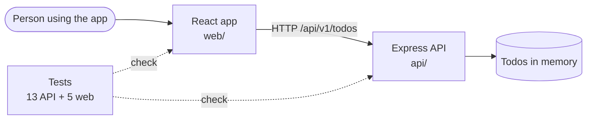

# Step 00: the starting point

**In one sentence:** this is a normal small project before any AI setup, so the next steps show
exactly what the setup adds.

**Who:** the lead (or whoever owns the project).

## The picture



What is **not** here yet: no `AGENTS.md` (the agent's instructions), no team skills, no MCP
servers, no guardrails. An agent opened in this folder knows nothing about how the team works.

## What you type

```bash
npm install
npm test
```

Expected: `13 passed` (API) and `5 passed` (web).

## What changed

The whole app, in one commit: [step-00](https://github.com/its-tahir/nextpak-ai-dlc-demo/tree/step-00).

## Tokens

None: no agent was used in this step.

<details>
<summary>Details for developers</summary>

- `api/` follows the team's Node standard: `app.ts` builds the app without listening (tests import
  it), feature module `modules/todos/` (routes, controller, service, repository, Zod schemas),
  one error shape `{ error: { code, message, requestId } }`, Pino logs with a request id,
  `helmet`, a CORS allowlist, `/healthz` and `/readyz`.
- `web/` follows the team's React standard: `features/todos/` with TanStack Query hooks, loading,
  error and empty states, an error boundary, labelled form fields.
- The app has one bug that no test covers yet. Step 02 shows how it comes to light.

</details>
