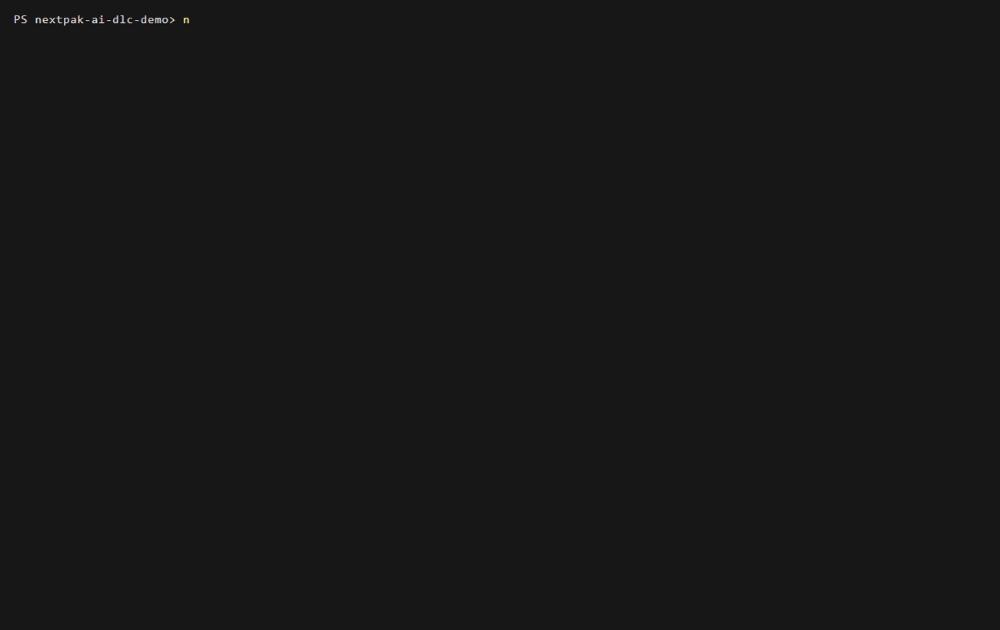
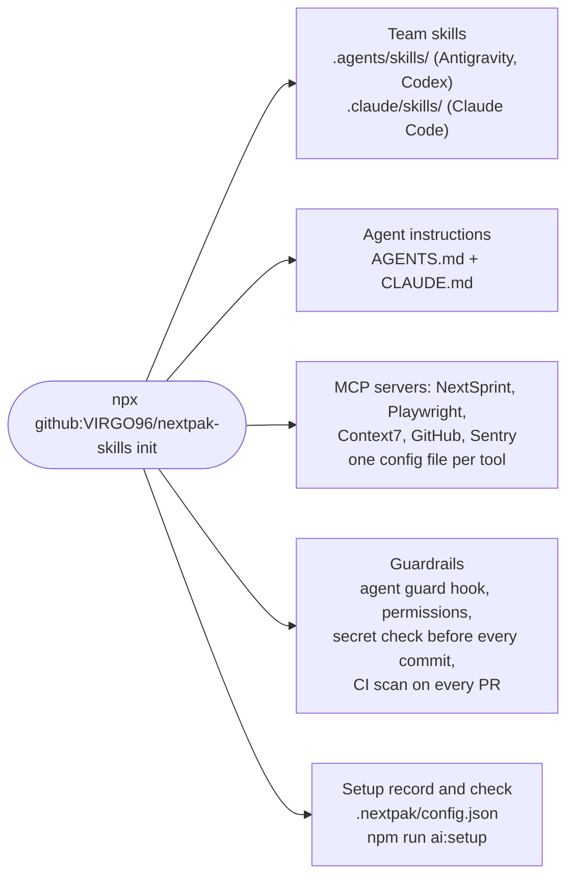

# Step 01: one command sets the project up

**In one sentence:** the lead runs one command in the project folder, answers five questions, and
the project gets the team's skills, agent instructions, MCP servers and guardrails for every AI
tool the team uses.

**Who:** the lead, once per project. Nothing to clone or install first (Node and git only).

## The picture





## What you type

```powershell
cd D:\dev\nextpak-ai-dlc-demo
npx github:VIRGO96/nextpak-skills init
```

| Question | Answer here | Why |
|---|---|---|
| You are on main. Create the branch chore/nextpak-ai-setup? | Enter (yes) | The setup goes through a pull request like any change |
| Stacks | Enter | It found `node` in `api/` and `react` in `web/` |
| AI tools the team uses | Enter (all) | Claude Code, Antigravity and Codex all get the same skills and rules |
| MCP groups | `core` | `frontend` is for Next.js, shadcn or Storybook projects; this app uses none of them |
| Team guardrails | Enter (yes) | |
| Lead's GitHub username | `its-tahir` | Changes to agent config need the lead's review (CODEOWNERS) |

Then check it:

```powershell
npm run ai:setup
```

It answers with `[ok]` lines, and `[todo]` lines that say exactly what is left (here: install
gitleaks, fill in AGENTS.md in step 02, add the GitHub MCP server to Antigravity's global config).

## What changed

One pull request, "chore: NextPak AI setup". Nothing in it is secret: tokens stay on each
developer's machine.

- 12 skills in `.agents/skills/` and the same 12 in `.claude/skills/`: the lifecycle skills
  (`ai-dlc`, `nextsprint-workflow`, `testing-qa`, `pr-ready`, `review-pr`, `docs-keeper`,
  `release-checklist`, `prompt-engineering`), two debugging and verification skills, and the
  two stack skills (`node-express-standards`, `react-next-standards`).
- `AGENTS.md`: which skill to load for which task, what to do with unclear requests, production
  and data safety, the MCP servers, the guardrails. `CLAUDE.md` points Claude Code to it.
- MCP config: `.mcp.json` (Claude Code), `.agents/mcp_config.json` (Antigravity),
  `.codex/config.toml` (Codex).
- Guardrails: `.guardrails/`, `.claude/settings.json`, `.codex/`, `.agents/hooks.json`,
  `.github/workflows/ai-guardrails.yml`, `.github/CODEOWNERS`, the PR template.
- `.nextpak/`: the choices made here (so `update` needs no questions) and the setup check.
- `package.json`: `ai:setup`, and `prepare` so `npm install` turns the git hooks on.

## Tokens

No agent was used. What the setup adds to every conversation (measured in Antigravity, Settings >
Customizations): the 12 skill descriptions, about 2,600 tokens; a skill's full text loads only when
a task needs it.

<details>
<summary>Details for developers</summary>

- Without questions: `npx github:VIRGO96/nextpak-skills init --yes --mcp core --lead its-tahir`.
- Later updates: `npx github:VIRGO96/nextpak-skills update` reuses the saved choices; team skills
  dropped upstream are removed, your own skills and settings are kept.
- The CI workflow "AI guardrails" runs gitleaks on every PR and flags changes to agent config for
  the lead's review.
- Source of everything installed: [VIRGO96/nextpak-skills](https://github.com/VIRGO96/nextpak-skills).

</details>
