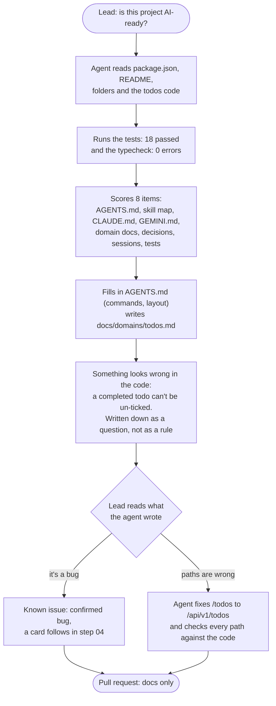

# Step 02: the agent checks the project is AI-ready

**In one sentence:** the lead asks the agent "is this project AI-ready?"; the agent reads the
project, runs the tests, fills in `AGENTS.md`, writes a short doc for each area of the code, and
reports what it is not sure about; the lead reads it all and corrects it before it is committed.

**Who:** the lead, with the agent (here: Antigravity).

## The picture



## What you type

In Antigravity, in a new conversation:

```text
is this project AI-ready?
```

Then the lead's corrections, in the same conversation:

```text
Two things before I commit:
1. The un-tick behaviour is a bug, not intended. In docs/domains/todos.md keep it under Known
   issues as a confirmed bug (no longer a question); a card will follow.
2. The API paths in docs/domains/todos.md are missing the /api/v1 prefix (the router is mounted
   in api/src/app.ts). Fix them, and check the other paths in that file against the code.
```

## What the agent reported

| Item | Result |
|---|---|
| AGENTS.md | Filled in: product, commands, layout, links (116 lines, under the 200 limit) |
| Skill map and guardrails | Already there from step 01 |
| CLAUDE.md / GEMINI.md | `@AGENTS.md` / absent (correct) |
| Domain docs | Created `docs/domains/todos.md` |
| Decisions / sessions | Created `docs/decisions/` and `sessions/` |
| Tests | `npm test`: 13 API + 5 web passed; `npm run typecheck`: 0 errors |

## Why the lead reads every line

Two things in the agent's first version needed a person:

- **A guess.** The doc said `GET /todos`; the real path is `GET /api/v1/todos`. The agent guessed
  from the router file instead of checking where the router is mounted. One sentence fixed it.
- **A decision.** The agent spotted that `completed || old value` ignores `false`, and wrote it
  down as a question instead of a rule. Whether that's a bug is the lead's call: it is, and it
  becomes a card in step 04.

The PR template asks for exactly this: "I read every line of this diff myself, including what the
agent wrote".

## What changed

`AGENTS.md`, `docs/domains/todos.md`, `docs/decisions/.gitkeep`, `sessions/.gitkeep`. No app code.

## Tokens

Always loaded in every conversation (Antigravity, Settings > Projects > Customizations): the
team's 12 skill descriptions about 2,600 tokens, `AGENTS.md` about 2,100, MCP tools about 600.
Antigravity doesn't show the tokens of one conversation yet; the same check with Claude Code took
40 steps, 2.5 minutes and about $0.65.

<details>
<summary>Details for developers</summary>

- The check is the `docs-keeper` skill, section A ("Readiness check"). It never invents: anything
  it can't confirm from the code, a command or a person becomes `TODO(question): ...`.
- `docs/domains/todos.md` lists its code paths, so the close-out step (09) knows which doc to
  update when those files change.
- Re-run "is this project AI-ready?" any time; it only creates what is missing.

</details>
