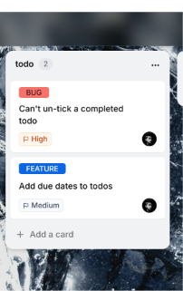
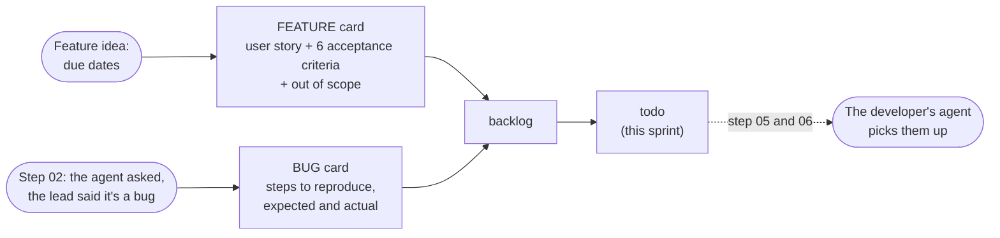
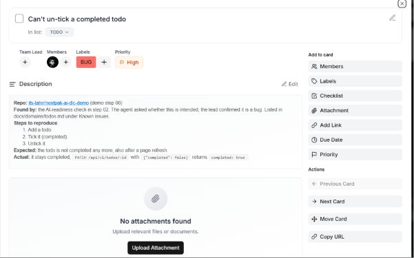

# Step 04: sprint planning, two cards on the board

**In one sentence:** the lead writes two cards on the NextSprint board, a feature and the bug the
agent found in step 02, each with what "done" means, and moves them to todo.

**Who:** the lead.

## The picture

## What a good card has

The agent works from the card, so the card has to say what the lead wants, in words a test can
check. Vague cards make the agent guess (step 07 shows what happens then).

**Feature: "Add due dates to todos"** (label FEATURE, priority medium)

- A user story: who wants it and why.
- Six acceptance criteria, each one testable, for example: "`GET /api/v1/todos?overdue=true`
  returns only todos that are not completed and whose due date is before today (today = the
  server's date in UTC)".
- Out of scope: reminders, times of day, sorting by date.

**Bug: "Can't un-tick a completed todo"** (label BUG, priority high)

- Where it was found (the readiness check in step 02), steps to reproduce, expected and actual.

## The board's lists

backlog, todo, doing, dev done, QA testing, client review, completed. The agent moves a card
from todo to doing when the developer starts it, and to dev done when the pull request is open.
It never goes further: QA testing and completed are for people.

## What changed

Two cards on the board, and this page. No app code.

## Tokens

None: the cards were written by the lead.

Details for developers

- The labels `BUG` and `FEATURE` matter: the `nextsprint-workflow` skill follows the bug path
  (a failing test first, root cause) for cards labelled `BUG`.
- Each card has an assignee and no team lead: NextSprint doesn't allow the same person as both,
  and in this demo the lead and the developer are one person.
- Acceptance criteria become the card's checklist when the work starts (step 05).

