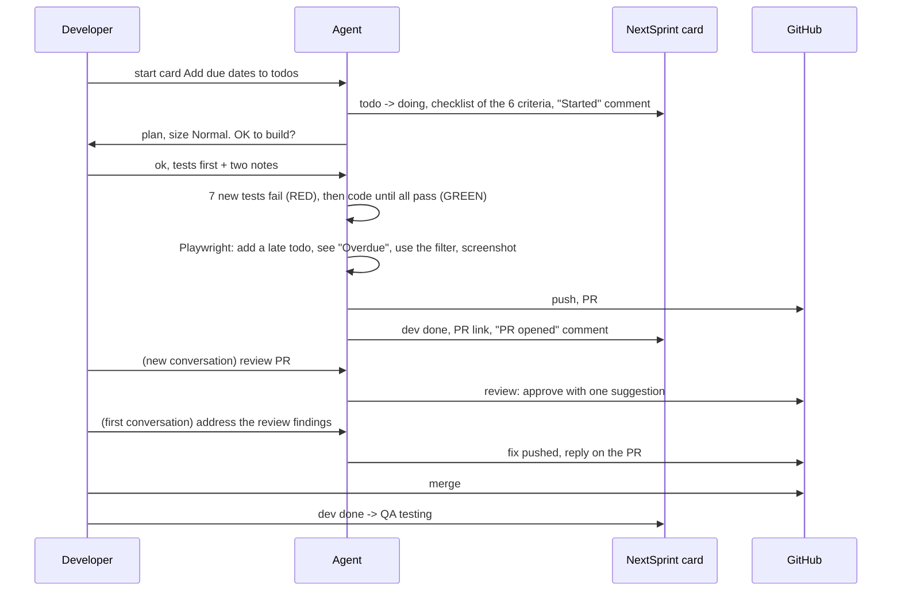
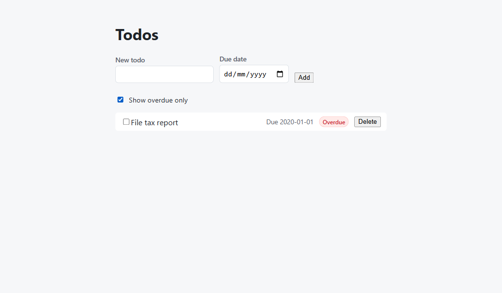

# Step 05: a feature card, from plan to pull request

**In one sentence:** the developer types "start card Add due dates to todos"; the agent moves the
card, plans, waits for the developer's OK, writes failing tests first, builds the feature, checks it
in a real browser, opens a pull request, a second agent reviews it, and the first one fixes what the
review found.

**Who:** the developer and the agent (Antigravity, Gemini 3.8 Flash); a fresh agent conversation as
the reviewer; the developer as QA at the end.

## The picture





The agent took this screenshot itself during the browser check: the late todo has the "Overdue"
label and the filter shows only overdue todos.

## What you type

```text
start card Add due dates to todos
```

The agent stopped before writing code and asked for an OK. The developer's answer:

```text
ok, go ahead, tests first. Two notes:
1. This changes the UI, so Verify is testing-qa level 2: one Playwright run of the main journey
   (add a todo with a past due date, see "Overdue", use the "Show overdue only" toggle) with a
   screenshot, before the PR.
2. "Overdue" in the UI follows the API rule (server date in UTC); don't compute it from the
   browser clock.
```

Then, when it asked to open the PR:

```text
yes, push the branch and open the PR. Put the Playwright result in the PR description.
```

The review, in a **new** conversation (so the reviewer doesn't know it wrote the code):

```text
review PR #5 (https://github.com/its-tahir/nextpak-ai-dlc-demo/pull/5) for the card Add due dates
to todos, as a teammate who didn't write it. Run the tests yourself, and post the review on the PR
as a comment.
```

And back in the first conversation:

```text
address the review findings on PR #5: apply the suggestion (pass todayUTC from the service to the
repository). Leave the PR size nit as is. Re-run the tests, push, and reply on the PR.
```

## What happened

| Phase | What the agent did | Evidence |
|---|---|---|
| Start | Card to doing, checklist from the 6 criteria, "Started" comment, branch `feat/add-due-dates-to-todos` | Card activity |
| Gate | Asked for an OK before writing code | The conversation |
| Tests first | 4 API and 3 web tests failed before the code (RED), all passed after (GREEN) | RED and GREEN output in the PR |
| Verify | 29 tests, typecheck, build; one Playwright run of the journey, 0 console errors, screenshot | The picture above |
| PR | [PR #5](https://github.com/its-tahir/nextpak-ai-dlc-demo/pull/5), CI green, card to dev done with the PR link | Card and PR |
| Review | Fresh agent: ran the tests, checked the screenshot, 6 of 6 criteria; one real suggestion ("today" was computed twice, so the filter and the label could disagree at midnight UTC) | Comment on PR #5 |
| Fix | One refactor commit, tests re-run, reply on the PR | Commit `44db8c8` |

## Where the developer stepped in

The agent did the work; the developer made three calls an agent shouldn't make alone:

- **The browser check.** The agent first planned "testing level 1" (no browser), but the feature
  changes the UI. One line in the OK fixed it.
- **A product rule.** Should the "Overdue" label use the browser's clock or the server's? Two
  clocks can disagree near midnight; the developer chose the server's, in the same reply.
- **What the criteria meant.** The first criterion says a due date can be set when a todo is
  "created or edited" and can be removed. The API does all three; the UI only sets it when a todo
  is created. Agent and reviewer both called it met. As QA, the developer accepted the card for the
  API and wrote a follow-up card for the UI. Lesson for the next card: say where ("in the UI",
  "in the API").

## What changed

12 files, +407 / -75: the API (schema, service, repository, tests), the web app (form, list, hooks,
tests, styles), and the todos domain doc. One more card on the board: "Change or remove a todo's
due date in the UI" (backlog).

## Tokens

Antigravity doesn't show the tokens of one conversation yet. For comparison, the same card in the
dry run with Claude Code (Sonnet) took about 100 steps, 15 minutes and $3.50, and the review about
4 minutes and $0.65.

<details>
<summary>Details for developers</summary>

- The API adds an `overdue` flag to every todo, computed on the server from its UTC date; the UI
  shows the label from that flag, so the label and the filter always agree.
- Dates are validated as real calendar dates (`2026-02-31` is rejected), `null` removes a date.
- The checklist items were set to `dev_done` by the agent; QA ticks them when testing.
- Seen once while reviewing: two UI tests failed when the machine was busy, then passed in four
  runs in a row. They wait up to 1 second for the screen; worth watching as a possible flaky test.

</details>
