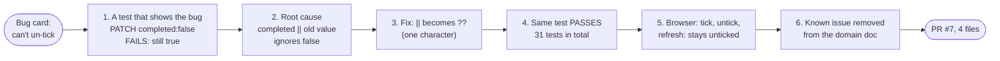
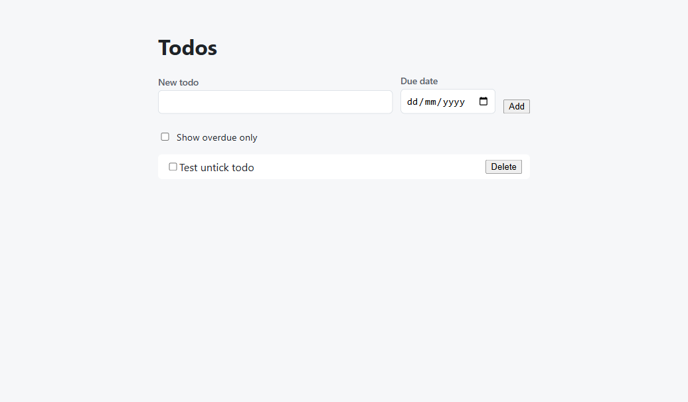

# Step 06: a bug card, a failing test first

**In one sentence:** the developer types "start card Can't un-tick a completed todo"; the agent
writes a test that shows the bug (it fails), fixes the cause, shows the test passing, checks it in a
browser, updates the doc that listed the bug, and opens a small pull request the developer reviews
and merges.

**Who:** the developer and the agent (Antigravity).

## The picture





## What you type

```text
start card Can't un-tick a completed todo
```

The agent planned the bug path and asked for an OK. The developer's answer:

```text
ok, go ahead. Three notes:
1. Run the new test before the fix and show me it fails (RED), then fix and show it passes (GREEN).
2. One quick Playwright check after the fix: add a todo, tick it, untick it, refresh the page, it
   stays unticked. Screenshot.
3. The fix makes the Known issues entry in docs/domains/todos.md wrong: update it in this same PR.
Then push and open the PR.
```

## The test that failed first

```text
FAIL  tests/todos.test.ts > PATCH /api/v1/todos/:id > un-ticks a completed todo
AssertionError: expected true to be false
  170|  const res = await request(app).patch(`/api/v1/todos/${id}`).send({ completed: false });
  172|  expect(res.body.data.completed).toBe(false);
```

`false || true` is `true`, so un-ticking never reached the data. `??` only falls back when the value
is missing, so `false` now counts. After the fix: 22 API and 9 web tests pass.

## Why a failing test first

A test that fails before the fix proves two things: that it really catches this bug, and that the
fix is what made it pass. It stays in the suite, so the bug can't come back unnoticed.

## Review: a person, for a small change

[PR #7](https://github.com/its-tahir/nextpak-ai-dlc-demo/pull/7) changes 4 files and about 17
lines, so the developer read the diff and merged it, without an agent review. Step 05 shows the
agent review for a bigger change. The card moved from dev done to QA testing.

## What we learned (and fixed in the team skills)

- The doc that listed the bug was updated in the same PR. In the dry run the agent had left it
  for "after merge"; a rule added to `ai-dlc` since then made the difference.
- The PR description came out broken: the agent passed it inline in PowerShell, where a backtick
  is an escape character, so code like `` `false` `` turned into odd characters. `pr-ready` now
  says to always write the description to a file and use `--body-file`.

## What changed

`api/src/modules/todos/todos.service.ts` (the fix), one API test, one web test,
`docs/domains/todos.md` (no known issues left).

## Tokens

Antigravity doesn't show per-conversation tokens yet. In the dry run with Claude Code the same card
took about 60 steps, 6 minutes and $1.25.

<details>
<summary>Details for developers</summary>

- The bug path is in the `ai-dlc` skill (section 4) and `systematic-debugging`: reproduce, find the
  root cause, fix the cause (not the symptom), regression test.
- The agent sized it Small: one file area, about an hour. Small still means tests first and a PR.
- Browser check level: the fix is in the API, but the bug was reported in the UI, so one quick run
  of that journey shows it is really gone for the user.

</details>
