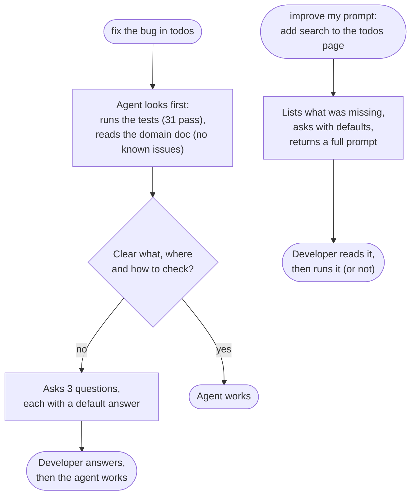

# Step 07: a vague request, and a better prompt

**In one sentence:** when a request is too vague to act on ("fix the bug in todos"), the agent looks
around, then asks what, where and how to check, with a suggested answer for each, instead of
guessing and changing code; and "improve my prompt: ..." turns a one-line idea into a prompt the
agent can work from.

**Who:** any developer, with the agent.

## The picture



## 1. A vague request

```text
fix the bug in todos
```

The agent ran the tests (31 pass) and read `docs/domains/todos.md` (no known issues: the last bug
was fixed in step 06). It changed nothing and asked:

| Question | Its suggested answer |
|---|---|
| What is the bug, or the expected behavior? | Describe the symptom or the steps (creating, editing, overdue, deleting) |
| Where does it happen? | The UI (`TodoList.tsx`, `AddTodoForm.tsx`) or the API (`todos.service.ts`) |
| How will we check it? | A failing test that shows the bug, the fix, then `npm test` |

This comes from the "Unclear requests" section of `AGENTS.md`: what, where and done-check; at
most three questions; each with a default. Without it, agents in our tests edited code on 5 out of
5 vague prompts; with it, 0 out of 5.

## 2. Improve my prompt

```text
improve my prompt: add search to the todos page
```

The agent (skill `prompt-engineering`) said what the one-liner was missing (search in the API or
only in the browser, which field, where the box goes, the empty state, how to check it), asked
three questions with defaults, and wrote a full prompt:

<details>
<summary>The prompt it wrote (shortened)</summary>

```markdown
## Task
Add search to filter todos by title.

## Context
Single repo: api/ (Express 5) and web/ (React 19 + Vite). Follow node-express-standards,
react-next-standards and testing-qa. Files: todos.schema.ts, todos.repository.ts,
todos.service.ts, todos.controller.ts, TodoList.tsx, api.ts, hooks.ts, the two test files, and
docs/domains/todos.md.

## Requirements
- API: optional `search` on GET /api/v1/todos (trimmed, max 100), case-insensitive title match,
  correct `total`; works together with `overdue=true`.
- UI: a search box (aria-label "Search todos"); no results shows: No todos matching "<query>".
- Docs: add ?search= to the domain doc.

## Constraints
Only the todos files and their tests; no new dependencies; keep the { data, meta } shape.

## Done when
Failing tests first (API: partial and case-insensitive match, no result, with overdue; UI: typing
filters the list, empty message), then npm test and npm run typecheck pass, output pasted.
```

</details>

The developer decides whether to run it; nothing changed until then. This demo doesn't run it.

## What to take from this

- A short, vague prompt costs a round of questions. A clear one (what, where, how to check) lets
  the agent start right away. The card in step 05 is an example of a clear one.
- "improve my prompt" is a quick way to get there: it asks before it assumes.

## What changed

This page. No code.

## Tokens

Two short conversations. In the dry run with Claude Code: about 13 steps and $0.25 for the vague
prompt, 9 steps and $0.19 for improve my prompt.

<details>
<summary>Details for developers</summary>

- The rule is in `AGENTS.md`, "Unclear requests: check before changing code", installed in step 01.
- `prompt-engineering` describes the situation and the done-check instead of an "expert" persona;
  it uses roles only when they change the job (reviewer, QA tester).

</details>
