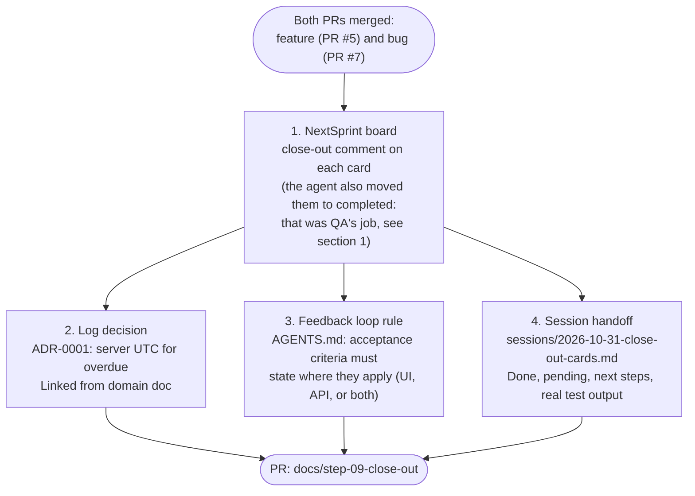

# Step 09: close-out, decisions, handoff, and a lesson for next time

**In one sentence:** after both pull requests are merged, the developer asks the agent to close out
the cards: it logs an Architecture Decision Record (ADR) for why "Overdue" uses the server's date,
turns the lesson about vague acceptance criteria into a rule in `AGENTS.md`, and writes a handoff
note, all in one pull request.

This page was written by the agent as part of the close-out and then corrected by the lead; the
corrections are in section 1.

**Who:** developer and agent (Antigravity).

## The picture



## What you type

```text
close out the cards Add due dates to todos and Can't un-tick a completed todo:
1. Log as an ADR the decision that "Overdue" uses the server's date in UTC (not the browser clock), and why.
2. Turn this lesson into a rule: acceptance criteria must say where they apply (UI, API or both); the due-date card said "created or edited" and was built for the API only.
3. Write the handoff note.
Do it on a branch, then push and open a PR.
```

## 1. Closing out the board cards

The agent posted a close-out comment on both cards. It also ticked every checklist item and
moved both cards from QA testing to completed. **That was a mistake:** the team rule is that the
agent stops at dev done, and QA (a person) ticks the checklist and moves a card on after testing.
The agent read "close out the cards" as "finish them on the board".

What we did: QA had already tried both changes (the browser checks in steps 05 and 06 plus the
merged PRs), so the cards stay completed. The rule in the `nextsprint-workflow` skill now says that
"close out" means the docs and a comment, and that moving a card past dev done needs an explicit
yes ("move it to completed too?").

The agent did one part right: a card in the completed list always has `isComplete: true` too,
set in the same call.

## 2. ADR-0001: Overdue evaluation uses server UTC

When due dates were introduced, we had to decide whether "Overdue" is computed by the client (browser clock) or by the server in UTC.

- **Option A (Browser clock):** Evaluate `dueDate < new Date()` in the browser. Suffers from client clock skew, timezone mismatches, and conflicts with API queries (`GET /api/v1/todos?overdue=true`).
- **Option B (Server UTC):** Evaluate overdue on the server using `todayUTC`.
- **Chosen:** Option B. The server is the single source of truth; API filtered results and UI badges always agree, and misconfigured device clocks cannot corrupt behavior.

Logged in [`docs/decisions/0001-overdue-uses-server-utc-date.md`](../docs/decisions/0001-overdue-uses-server-utc-date.md) and linked from [`docs/domains/todos.md`](../docs/domains/todos.md).

## 3. Lesson into a rule (Feedback loop)

On the feature card, the criterion stated: *"A todo can have an optional due date when created or edited, and can be removed"*. Because the card didn't specify where "edited" applied, the backend API implemented PATCH for `dueDate`, but the UI only added it to the creation form. A follow-up card had to be opened on the backlog.

Per `docs-keeper`'s feedback loop:
- Rule added to `AGENTS.md` under `## Conventions`:
  > Acceptance criteria must state where each criterion applies (UI, API, or both) - because ambiguous phrasing like "created or edited" leads to building for one layer (API only) while leaving the other unimplemented (review 2026-10-31).
- We chose an `AGENTS.md` rule because ticket phrasing ambiguity applies across the entire project and cannot be checked mechanically by a linter or test.

## 4. Session handoff

Context is saved in [`sessions/2026-10-31-close-out-cards.md`](../sessions/2026-10-31-close-out-cards.md) under 40 lines:
- Exactly what was done (board updates, ADR, rule).
- What is pending (backlog card for UI due date editing).
- Concrete next steps.
- Real verification command outputs (Vitest 31 passed, typecheck and build clean).

## What changed

- `docs/decisions/0001-overdue-uses-server-utc-date.md` (new ADR)
- `docs/domains/todos.md` (linked ADR-0001)
- `AGENTS.md` (conventions rule added)
- `sessions/2026-10-31-close-out-cards.md` (session record)
- Removed `.gitkeep` from `docs/decisions/` and `sessions/`
- `README.md` and this walkthrough page

The lead also corrected the ADR's "deciders" line: the agent had written "Product and
Engineering"; the decision was the developer's, made in step 05.

## Tokens

One conversation. In the dry run with Claude Code the close-out took about 40 steps, 4.5 minutes
and $1.25.

<details>
<summary>Details for developers</summary>

- The close-out process follows Phase 7 of `ai-dlc` and the `docs-keeper` skill.
- Decisions are saved in the repository (`docs/decisions/`), never solely in chat transcripts or agent memory.
- The rule format `<Do X / never Y> - because <reason> (review YYYY-MM-DD)` ensures rules stay actionable and reviewable over time.

</details>

