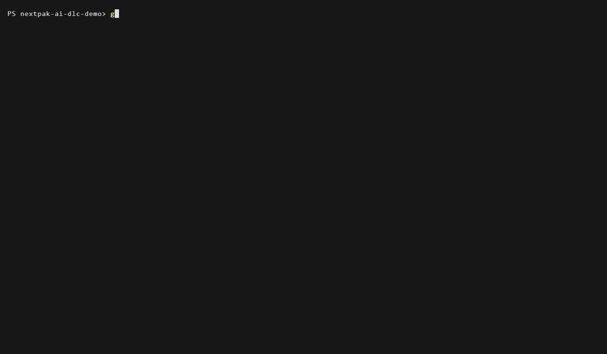
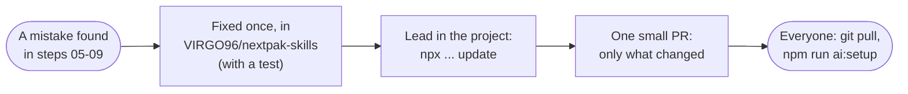

# Step 10: team updates arrive in one command

**In one sentence:** the fixes the team made to its skills and guardrails while running this demo
reach the project with one command, `update`, as one small pull request, with no questions asked.

**Who:** the lead. Then every developer runs `git pull` and `npm run ai:setup`.

## The picture





## What you type

```powershell
git switch -c chore/update-nextpak-setup
npx github:VIRGO96/nextpak-skills update
git status
```

No questions: the choices from step 01 are saved in `.nextpak/config.json`.

## What came in

Version 1.0.6 to 1.0.10. Six files, three fixes, each one from a mistake seen in this demo:

| Fix | From step | Files |
|---|---|---|
| Write the PR description to a file (`--body-file`); never advise a force-push the guardrails block | 06 (broken PR description) | `pr-ready` skill, for both tool folders |
| "Close out the card" is not an OK to move it; moving past dev done needs a yes | 09 (cards moved to completed) | `nextsprint-workflow` skill, for both tool folders |
| Reading one secret variable gets its own message | 08 (wrong message) | `.guardrails/agent-guard.mjs` |

Plus `.nextpak/config.json` (the new version). `AGENTS.md`, the project's docs and code are not
touched: `update` only replaces what the team owns, and keeps the project's own additions.

## Why it matters

The rules get better every time someone finds a gap, and every project gets the better rules the
same way, through a pull request someone reads. Nobody copies files by hand, so projects don't
drift apart.

## What changed

The six files above, and this page.

## Tokens

None: no agent was used. The updated skill descriptions are the same length as before.

<details>
<summary>Details for developers</summary>

- `update` reuses the saved stacks, tools, MCP groups and lead. Add a group with
  `npx github:VIRGO96/nextpak-skills update --mcp database`.
- Team skills that were removed upstream are removed here too; skills the project added itself are
  kept.
- The pre-commit check and CI run on this PR like any other; changes to agent config are flagged for
  the lead's review.

</details>
